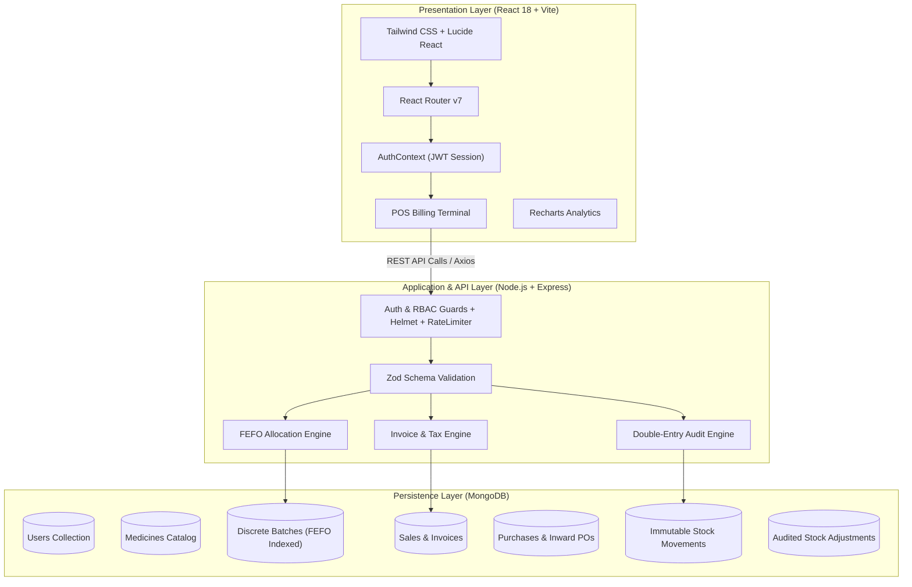

# Pharmacy Management System (Algions Rx)
**Algions AI Labs Private Limited | Full-Stack Internship Assessment**

[](https://www.typescriptlang.org/)
[](https://react.dev/)
[](https://nodejs.org/)
[](https://expressjs.com/)
[](https://www.mongodb.com/)
[](https://tailwindcss.com/)
[](https://vitest.dev/)
[](LICENSE)

An enterprise-grade, full-stack pharmacy business application engineered to meet real-world pharmaceutical distribution, clinical compliance, and point-of-sale requirements. Built for the **Algions AI Labs 15-Day Full-Stack Internship Assessment**.

---

## 📑 Table of Contents
1. [Key Capabilities & Innovations](#1-key-capabilities--innovations)
2. [Demo Credentials](#2-demo-credentials)
3. [Technology Architecture](#3-technology-architecture)
4. [Project Directory Layout](#4-project-directory-layout)
5. [Local Development Quick Start](#5-local-development-quick-start)
6. [Automated Verification & Test Suite](#6-automated-verification--test-suite)
7. [REST API Inventory](#7-rest-api-inventory)
8. [Deployment Guide](#8-deployment-guide)
9. [Documentation Deliverables](#9-documentation-deliverables)

---

## 1. Key Capabilities & Innovations

- **Discrete Batch Inventory Tracking:** Medicine stock is never stored as an undifferentiated scalar integer. Every lot is independently tracked with its supplier, manufacturing date, expiry date, purchase cost, selling price, and available balance.
- **Automated FEFO (First-Expiry-First-Out) Engine:** High-performance compound indexes (`{ medicine: 1, expiryDate: 1, availableQuantity: 1 }`) guarantee that sales deplete earliest-expiring active batches first, preventing stock obsolescence and expired dispensing.
- **Point of Sale (POS) Billing & Instant Invoices:** Fast medicine search by brand, generic name, or barcode; live visual FEFO batch allocation previews; automatic GST (12%) calculation; discount controls; and instant print-ready tax invoices (`window.print()`).
- **Goods Inward Consignment (Purchases):** Complete inward PO receiving workflow that ingests supplier batches, snapshots costs, and updates physical inventory.
- **Audited Customer Returns & Restock Safety:** Strict over-return prevention with condition-based quarantine (undamaged goods safely restored to active lot; damaged or expired goods permanently quarantined without inflating sellable stock).
- **Non-Negative Stock Adjustments:** Regulatory inventory corrections (`COUNT_CORRECTION`, `DAMAGED_GOODS`, `EXPIRED_STOCK`, `THEFT_OR_LOSS`) with mandatory remarks and strict negative stock prevention.
- **Double-Entry Mathematical Stock Reconciliation:** Append-only ledger auditing algorithm verifying:
  $$\text{Opening} + \text{Inward} + \text{Customer Returns} - \text{Sales} \pm \text{Adjustments} \equiv \text{Current Batch Balance}$$
- **Role-Based Access Control (RBAC):** Server-side authorization protecting administrative workflows across Administrator, Pharmacist, and Customer tiers.

---

## 2. Demo Credentials

The database seed pipeline provisions pre-configured demo accounts. You can log in manually or use the one-click demo presets on the login screen (`/login`):

| Role | Email | Password | Access Level |
| :--- | :--- | :--- | :--- |
| **Administrator** | `admin@pharmacy.com` | `Admin@123` | Full access: Users, Catalog, POS, Stock, Reports |
| **Pharmacist** | `pharmacist@pharmacy.com` | `Pharmacist@123` | POS Billing, Inward Consignments, Returns |
| **Customer** | `customer@pharmacy.com` | `Customer@123` | Browse fictional medicine catalogue |

*(Secondary credentials `admin@pharmacare.com` / `AdminPassword@123` are also provisioned by the seed).*

---

## 3. Technology Architecture



---

## 4. Project Directory Layout

```
Algions/
├── backend/
│   ├── src/
│   │   ├── config/          # Database connection & environment configuration
│   │   ├── controllers/     # Express route handlers
│   │   ├── database/        # Automated database seed pipeline
│   │   ├── middleware/      # Auth, RBAC guards, rate limiter, error handler
│   │   ├── models/          # 10 Mongoose domain models & schemas
│   │   ├── routes/          # REST route declarations
│   │   ├── services/        # Business logic: FEFO, inventory, sales, returns, reports
│   │   ├── tests/           # End-to-end integration test suites
│   │   ├── utils/           # JWT signer, formatters, password utilities
│   │   ├── validators/      # Zod schema definitions
│   │   ├── app.ts           # Express application setup
│   │   └── server.ts        # Server entry point
│   ├── package.json
│   └── tsconfig.json
├── frontend/
│   ├── src/
│   │   ├── components/      # UI components: Navbar, Sidebar, Modals, Badges, Cards
│   │   ├── context/         # AuthContext & session management
│   │   ├── pages/           # Dashboard, POS, Medicines, Inventory, Purchases, Returns, Reports, Users
│   │   ├── services/        # Axios API client & endpoints
│   │   ├── types/           # TypeScript domain definitions
│   │   ├── App.tsx          # React application routes
│   │   └── main.tsx         # React root mounting
│   ├── package.json
│   ├── tailwind.config.js
│   ├── vercel.json          # Vercel SPA rewrite configuration
│   └── vite.config.ts
├── docs/
│   ├── api/
│   │   └── API_REFERENCE.md # Complete REST API specification
│   ├── architecture/
│   │   └── DATABASE_DESIGN.md # Detailed Mongoose ER diagram & indexing strategy
│   └── reports/
│       └── TECHNICAL_REPORT.md # 15-day internship assessment technical report
├── render.yaml              # Render blueprint deployment specification
├── README.md
└── .gitignore
```

---

## 5. Local Development Quick Start

### Prerequisites
- Node.js >= 20.x
- MongoDB (Running locally on `mongodb://127.0.0.1:27017` or MongoDB Atlas URI)
- Git

### 1. Clone the Repository
```bash
git clone https://github.com/Charan57290/Algions.git
cd Algions
```

### 2. Configure Backend Environment
Create `backend/.env` (or copy from `.env.example`):
```env
PORT=5000
NODE_ENV=development
MONGODB_URI=mongodb://127.0.0.1:27017/pharmacy_management
JWT_SECRET=super_secret_pharmacy_jwt_key_2026_dev
JWT_EXPIRES_IN=7d
CLIENT_URL=http://localhost:5173
```

### 3. Install Dependencies & Seed Database
```bash
# In the backend directory:
cd backend
npm install
npm run seed     # Ingests demo accounts, therapeutic categories, suppliers, medicines, and batches
```

### 4. Run Backend Server
```bash
npm run dev      # Starts Express API server on http://localhost:5000
```

### 5. Run Frontend Development Server
In a separate terminal:
```bash
cd frontend
npm install
npm run dev      # Starts Vite client on http://localhost:5173
```

Open [http://localhost:5173](http://localhost:5173) in your browser. Use the one-click demo credentials on `/login` to access the application.

---

## 6. Automated Verification & Test Suite

The system maintains a comprehensive test suite of **101 automated tests across 10 test suites** verifying all layers from database indexing to end-to-end pharmaceutical transactions:

```bash
cd backend
npm test
```

### Summary of Passing Test Suites:
- `health.test.ts` (2 tests): Connectivity & database uptime checks
- `models.test.ts` (14 tests): Unique compound indexes, password hashing hooks, slug auto-generation
- `auth.test.ts` (21 tests): Registration, login, profile updates, RBAC middleware guards
- `masterData.test.ts` (19 tests): Category, supplier, and medicine CRUD, search, and stock aggregation
- `fefo.service.test.ts` (5 tests): Non-mutating FEFO previews, earliest-expiry sorting, expired lot exclusion
- `inventory.test.ts` (6 tests): Batch creation, purchase receiving, valuation calculations
- `sale.test.ts` (6 tests): POS transactions, atomic batch depletion, invoice generation
- `returnsAndAdjustments.test.ts` (9 tests): Restockable vs. quarantined returns, audited stock adjustments
- `report.test.ts` (5 tests): Executive dashboard KPIs, expiry risk tiers, stock reconciliation
- `e2ePharmacyLifecycle.test.ts` (14 tests): End-to-end simulation of the full pharmaceutical business lifecycle

---

## 7. REST API Inventory

Comprehensive parameter, header, and response documentation is provided in [docs/api/API_REFERENCE.md](docs/api/API_REFERENCE.md).

| Method | Endpoint | Access Role | Description |
| :--- | :--- | :--- | :--- |
| `POST` | `/api/auth/register` | Public | Register a new customer account |
| `POST` | `/api/auth/login` | Public | Authenticate and obtain JWT token |
| `GET` | `/api/auth/me` | Authenticated | Retrieve authenticated user profile |
| `GET` | `/api/users` | Admin | List all registered staff and customer accounts |
| `PATCH` | `/api/users/:id/status` | Admin | Activate or suspend user accounts |
| `GET` | `/api/categories` | Authenticated | List therapeutic medicine categories |
| `POST` | `/api/categories` | Admin | Create a new category |
| `GET` | `/api/suppliers` | Admin, Pharmacist | List pharmaceutical suppliers and vendors |
| `POST` | `/api/suppliers` | Admin | Register a new supplier |
| `GET` | `/api/medicines` | Authenticated | Search medicines with aggregated batch stock |
| `POST` | `/api/medicines` | Admin | Register a new medicine SKU |
| `GET` | `/api/batches` | Admin, Pharmacist | View discrete batches and expiry timelines |
| `GET` | `/api/batches/fefo-preview` | Admin, Pharmacist | Preview FEFO allocation without database mutations |
| `GET` | `/api/batches/valuation` | Admin, Pharmacist | Compute purchase and retail inventory valuations |
| `POST` | `/api/purchases` | Admin, Pharmacist | Inward goods receipt (creates batches & movements) |
| `POST` | `/api/sales` | Admin, Pharmacist | POS billing checkout with automated FEFO depletion |
| `GET` | `/api/sales/:id/invoice` | Authenticated | Generate formatted, print-ready tax invoice |
| `POST` | `/api/returns` | Admin, Pharmacist | Customer return with restock safety quarantine |
| `POST` | `/api/adjustments` | Admin, Pharmacist | Audited stock adjustment with non-negative guard |
| `GET` | `/api/reports/dashboard` | Admin, Pharmacist | Operational dashboard KPIs and 7-day sales trend |
| `GET` | `/api/reports/sales` | Admin | Sales, COGS, and gross profit margin report |
| `GET` | `/api/reports/expiry-risk` | Admin, Pharmacist | Expiry risk classification tiers (Critical, High, Moderate) |
| `GET` | `/api/reports/reconciliation` | Admin | Double-entry stock movement reconciliation audit |

---

## 8. Deployment Guide

### Backend on Render
The repository includes a root `render.yaml` deployment blueprint:
1. Connect your GitHub repository to [Render](https://render.com).
2. Choose "Blueprint" deployment to auto-configure the web service.
3. Configure the `MONGODB_URI` environment variable pointing to your MongoDB Atlas cluster.
4. Render builds using `cd backend && npm install && npm run build` and runs `cd backend && npm start`.

### Frontend on Vercel
The repository includes `frontend/vercel.json` with SPA route rewrites:
1. Import the repository on [Vercel](https://vercel.com).
2. Set Root Directory to `frontend`.
3. Set Build Command to `npm run build` and Output Directory to `dist`.
4. Configure `VITE_API_BASE_URL` pointing to your deployed backend URL.

---

## 9. Documentation Deliverables

- 📘 [API Specification](docs/api/API_REFERENCE.md): Comprehensive endpoint parameters and response schemas.
- 📐 [Database Design & Architecture](docs/architecture/DATABASE_DESIGN.md): Entity relationship model and indexing strategy.
- 📑 [Assessment Technical Report](docs/reports/TECHNICAL_REPORT.md): In-depth 15-day assessment submission document covering technical challenges, FEFO algorithms, quality assurance metrics, and security.

---

## License & Attribution

Developed by **Thota Kalicharan** for the **Algions AI Labs Private Limited** Full-Stack Web Development Internship Assessment. Released under the [MIT License](LICENSE).
