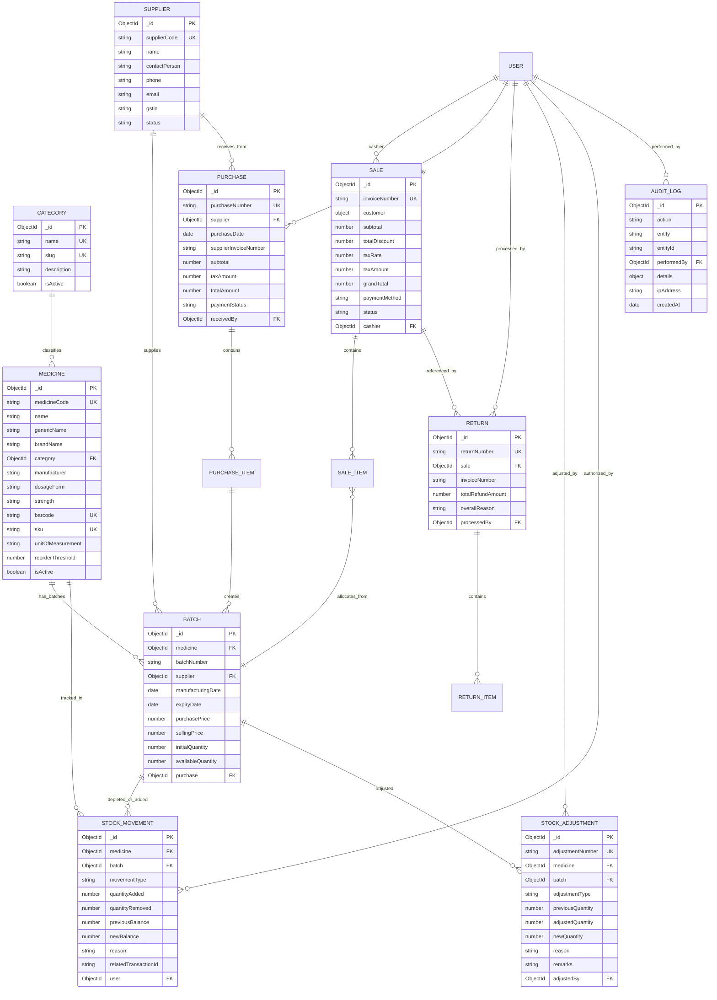

# Pharmacy Management System — Database Architecture & ER Design

**Algions AI Labs | Full-Stack Internship Assessment**  
**Author:** Thota Kalicharan ([@Charan57290](https://github.com/Charan57290))

---

## 1. Architectural Principles & Schema Decisions

### 1.1 Discrete Batch Tracking vs. Aggregate Inventory
Traditional retail systems often maintain a single `quantity` field on a product table. In pharmaceuticals, this approach is catastrophic:
- Medicines expire at specific dates.
- Regulatory recalls apply to specific lot/batch numbers.
- Purchase costs fluctuate per consignment.

**Our Architecture:**
- The `Medicine` collection stores immutable master catalog data (chemical formula, generic name, brand, dosage form, strength, SKU, and barcode).
- The `Batch` collection tracks individual production lots with distinct manufacturing dates, expiration dates, purchase prices, selling prices, and real-time available quantities.
- Every sale or deduction depletes units directly from designated batches, never from an abstract medicine counter.

### 1.2 FEFO (First-Expiry-First-Out) Optimization Index
To execute real-time FEFO allocation in sub-millisecond queries, the `Batch` collection employs a high-performance compound index:
```javascript
BatchSchema.index({ medicine: 1, expiryDate: 1, availableQuantity: 1 });
```
When a customer requests $N$ units of Medicine $M$, the database fetches active batches where `availableQuantity > 0` and `expiryDate > currentDate`, sorted ascending by `expiryDate`.

### 1.3 Immutable Double-Entry Stock Movement Ledger
To ensure complete reconcilability, no inventory quantity is ever updated silently. Every purchase received, sale completed, customer return, or audited adjustment writes an immutable record to the `StockMovement` collection:
- `previousBalance`
- `quantityAdded`
- `quantityRemoved`
- `newBalance`
- `movementType`
- `relatedTransactionId`
- `user` (staff member responsible)

---

## 2. Entity-Relationship (ER) Diagram



---

## 3. Entity Specification

| Entity | Primary Responsibility | Key Constraints & Indexes |
| :--- | :--- | :--- |
| **User** | Authentication & RBAC (`ADMIN`, `PHARMACIST`, `CUSTOMER`) | Unique index on `email`, bcrypt hashed passwords. |
| **Category** | Drug classification & filtering | Unique index on `name` and `slug`. |
| **Supplier** | Pharmaceutical vendors & logistics partners | Unique index on `supplierCode`. |
| **Medicine** | Master pharmaceutical catalog | Unique indices on `medicineCode`, `sku`, `barcode`. Full-text index on search attributes. |
| **Batch** | Discrete lot inventory with expiry dates | Compound unique `{ medicine: 1, batchNumber: 1 }`. Compound index `{ medicine: 1, expiryDate: 1, availableQuantity: 1 }`. |
| **Purchase** | Inward inventory consignments | Unique index on `purchaseNumber`. |
| **Sale** | POS customer billing & invoicing | Unique index on `invoiceNumber`. Index on `createdAt`. |
| **Return** | Customer returns linked to original sale | Unique index on `returnNumber`. Foreign key reference to `Sale`. |
| **StockMovement** | Immutable stock ledger | Indices on `batch`, `medicine`, and `createdAt`. |
| **StockAdjustment** | Audited physical stock modifications | Unique `adjustmentNumber`. Mandatory reason enum. |
| **AuditLog** | System-wide immutable security trail | Read-only once written; timestamps on every event. |
