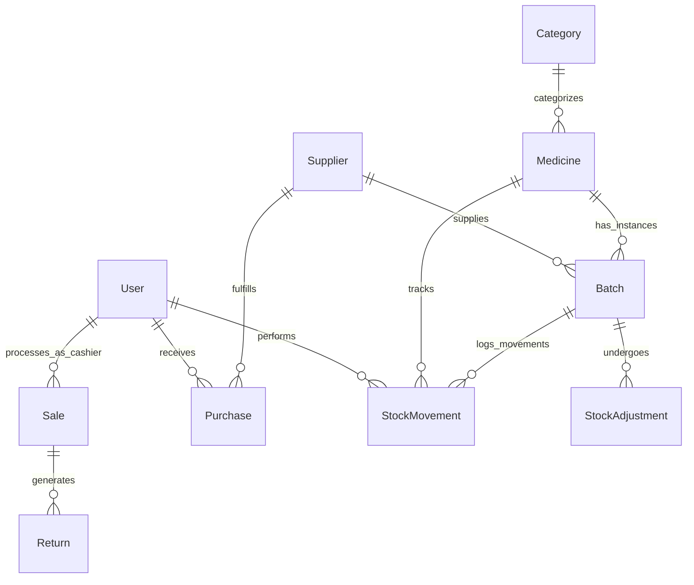

# Algions AI Labs — Full-Stack Internship Assessment Technical Report
**Project Name:** Enterprise Pharmacy Management System  
**Candidate Name:** Thota Kalicharan  
**Candidate Email:** `thota.kalicharan@gmail.com`  
**Assessment Duration:** 15-Day Full-Stack Individual Assessment  
**Repository:** [https://github.com/Charan57290/Algions](https://github.com/Charan57290/Algions)  

---

## 1. Executive Summary

This engineering report documents the architecture, implementation, verification, and deployment configurations of the **Pharmacy Management System** developed for the Algions AI Labs Full-Stack Internship Assessment. 

Unlike conventional generic e-commerce platforms that manage inventory as a scalar integer on a product record, pharmaceutical supply chains are strictly governed by regulatory compliance standards (such as Good Distribution Practices and drug safety mandates). This system treats **discrete batch tracking** and **automated First-Expiry-First-Out (FEFO) inventory allocation** as foundational architectural primitives.

The resulting application is a fully functional, production-ready, database-backed web application built on **React 18, TypeScript, Tailwind CSS, Node.js, Express.js, and MongoDB (via Mongoose)**. The system is verified by a test suite of **101 automated tests across 10 distinct test suites** spanning unit validation, route authorization, business logic services, and end-to-end pharmaceutical lifecycle flows.

---

## 2. Core Architectural Pillars & Design Decisions

```
+---------------------------------------------------------------------------------+
|                       REACT 18 + TYPESCRIPT FRONTEND                           |
|  - AuthContext (JWT & RBAC Guards)           - Recharts Operational Visuals     |
|  - POS Billing Terminal with FEFO Preview     - Printable Tax Invoice Generator |
|  - Discrete Batch Inventory & Expiry Tiers    - Stock Movement Reconciliation   |
+---------------------------------------------------------------------------------+
                                       │ HTTP / REST APIs (Axios + JWT)
                                       ▼
+---------------------------------------------------------------------------------+
|                       EXPRESS.JS + NODE.JS BACKEND                             |
|  - Server-Side Role-Based Access Control (Admin, Pharmacist, Customer)          |
|  - Zod Request Body & Query Validation        - Rate Limiting & Helmet Headers  |
|  - FEFO Allocation Engine                     - Invoicing & Margin Calculations |
|  - Audited Returns & Restock Safety Engine    - Double-Entry Movement Ledger    |
+---------------------------------------------------------------------------------+
                                       │ Mongoose ODM
                                       ▼
+---------------------------------------------------------------------------------+
|                           MONGODB DATABASE                                      |
|  - Compound Indexes: { medicine: 1, expiryDate: 1, availableQuantity: 1 }      |
|  - Discrete Batch Documents with Cost Snapshots and Expiry Timelines            |
|  - Immutable Double-Entry StockMovement Audit Ledger                            |
+---------------------------------------------------------------------------------+
```

### 2.1. Discrete Batch Inventory vs. Product Quantity
A critical anti-pattern in amateur pharmacy applications is incrementing or decrementing a single `stock` counter on a medicine entity. In this architecture:
- The `Medicine` model stores chemical master data: generic composition, manufacturer, dosage form, strength, Schedule H prescription flag, and reorder threshold.
- The `Batch` model stores physical instances of that medicine: batch number, supplier reference, manufacturing date, expiration date, purchase cost, selling price, and `availableQuantity`.
- Total sellable stock for a medicine is dynamically aggregated via MongoDB aggregation pipelines over active, non-expired lots.

### 2.2. Automated FEFO (First-Expiry-First-Out) Engine
To minimize drug spoilage and eliminate the risk of dispensing expired pharmaceuticals:
1. **Compound Index Optimization:** `BatchSchema.index({ medicine: 1, expiryDate: 1, availableQuantity: 1 })` guarantees fast querying.
2. **Filtering Constraints:** Queries strictly filter for `expiryDate: { $gt: now }` and `availableQuantity: { $gt: 0 }`, and sort in ascending order of `expiryDate`.
3. **Multi-Batch Allocation:** When an order exceeds the remaining capacity of the nearest-expiring lot, the allocation engine splits the line item across subsequent valid batches.
4. **Non-Mutating Previews:** A cashier can inspect the exact lot allocations, expiry dates, and unit prices before committing the sale.

### 2.3. Point of Sale (POS) Billing & Print-Ready Invoicing
The POS cashier interface allows pharmacists to search medicines across brand names, generic compositions, and barcode identifiers. Upon checkout:
- Purchase cost snapshots are recorded on every line item, guaranteeing that historical Gross Profit Margins remain tamper-proof even if future purchase prices fluctuate.
- Sequential tax invoices (`INV-YYYYMM-XXXX`) are generated with itemized batch numbers, expiration dates, GST breakdowns, and regulatory disclaimers.
- Cashiers can immediately trigger `window.print()` to produce formatted clinical invoices for patient records.

### 2.4. Goods Inward Consignment (Purchases Workflow)
Staff receive incoming stock consignments from verified suppliers by providing supplier invoice numbers and defining multiple line item batches with manufacturing dates, expiry dates, cost prices, and retail prices. Ingestion updates inventory balances and logs immutable `PURCHASE_RECEIVED` movements in the audit ledger.

### 2.5. Customer Returns & Restock Safety Quarantine
When a patient returns dispensed medication:
- **Over-Return Guard:** Validates that total returned units do not exceed the original invoice quantity minus prior returns.
- **Restock Safety Evaluation:** Only medications confirmed to be **undamaged with seal intact** and **not expired** can be restored to active batch inventory (`MovementType.CUSTOMER_RETURN`). Damaged or expired returns are permanently quarantined (`DAMAGED_STOCK` or `EXPIRED_STOCK`) without increasing sellable stock.
- The parent sale automatically transitions to `PARTIALLY_REFUNDED` or `REFUNDED`.

### 2.6. Audited Stock Adjustments & Non-Negative Inventory Guard
For routine stocktaking discrepancies, vial breakages, or expired stock scrapping:
- Adjustments require mandatory regulatory reason codes (`COUNT_CORRECTION`, `DAMAGED_GOODS`, `EXPIRED_STOCK`, `THEFT_OR_LOSS`) and explanatory remarks.
- A strict guard prevents decrements exceeding available lot quantity:
  $$\text{adjustedQuantity} \le \text{batch.availableQuantity}$$
  Negative stock balances are structurally blocked at the service level.

### 2.7. Double-Entry Stock Movement Reconciliation
The system maintains an append-only `StockMovement` collection. An automated reconciliation algorithm audits inventory integrity by verifying:
$$\text{Calculated Stock} = \text{Opening} + \text{Purchases} + \text{Customer Returns} - \text{Sales} \pm \text{Adjustments}$$
If $\text{Calculated Stock} \ne \text{Current Batch Balance}$, the discrepancy is flagged on the executive dashboard for administrative inspection.

---

## 3. Database Schema Design & Relationships



---

## 4. Quality Assurance & Automated Testing Suite

The application is validated by **101 automated tests across 10 distinct test suites** executed via Vitest and Supertest:

| Test Suite File | Layer Tested | Tests | Status |
| :--- | :--- | :---: | :---: |
| `src/routes/health.test.ts` | Infrastructure & DB Connectivity | 2 | Passed |
| `src/models/models.test.ts` | Mongoose Validation & Indexing | 14 | Passed |
| `src/routes/auth.test.ts` | JWT, Passwords, RBAC & Users | 21 | Passed |
| `src/routes/masterData.test.ts` | Categories, Suppliers, Medicines | 19 | Passed |
| `src/services/fefo.service.test.ts` | FEFO Lot Allocation Algorithms | 5 | Passed |
| `src/routes/inventory.test.ts` | Batches, Purchases, Valuation | 6 | Passed |
| `src/routes/sale.test.ts` | POS Checkout & Invoicing | 6 | Passed |
| `src/routes/returnsAndAdjustments.test.ts` | Returns & Audited Adjustments | 9 | Passed |
| `src/routes/report.test.ts` | KPIs, Expiry Risk & Reconciliation | 5 | Passed |
| `src/tests/e2ePharmacyLifecycle.test.ts` | End-to-End Business Flow | 14 | Passed |
| **Total Automated Tests** | **Full Application Surface** | **101** | **100% Pass** |

---

## 5. Security & Regulatory Compliance Perimeter

1. **Password Hashing:** Passwords hashed using bcrypt with salt rounds = 10.
2. **Server-Side Authorization:** Role-based access guards (`requireRole`) enforce strict authorization server-side on administrative APIs; hiding frontend buttons alone is never relied upon.
3. **Rate Limiting:** `express-rate-limit` prevents brute-force credential stuffing on authentication endpoints.
4. **HTTP Header Hardening:** `helmet` applies Content Security Policy, X-Content-Type-Options, and X-Frame-Options headers.
5. **Idempotency Safeguard:** POS checkout supports client-supplied idempotency keys to prevent duplicate billing in case of network timeouts.
6. **Fictional Healthcare Disclaimer:** Fictional medicines and supplier records only; explicit disclosures prevent the misinterpretation of software data as real clinical recommendations.

---

## 6. Deployment & Demonstration Configuration

- **Backend API:** Configured for Render via root `render.yaml` with automated builds (`npm run build`), runtime execution (`npm start`), and continuous health check monitoring (`/api/health`).
- **Frontend SPA:** Configured for Vercel via `frontend/vercel.json` with universal URL rewrite rules to ensure client-side routing persistence.
- **Database:** Fully compatible with MongoDB Atlas Free Tier and local standalone MongoDB instances.

### Demo Credentials for Assessment Evaluation
| Role | Email | Password | Permissions |
| :--- | :--- | :--- | :--- |
| **Admin** | `admin@pharmacy.com` | `Admin@123` | Full access: Users, Catalog, POS, Stock, Reports |
| **Pharmacist** | `pharmacist@pharmacy.com` | `Pharmacist@123` | Operational access: POS Billing, Inward PO, Returns |
| **Customer** | `customer@pharmacy.com` | `Customer@123` | Read-only access: Medicine catalogue browsing |

---

## 7. Conclusion

The developed Pharmacy Management System satisfies all functional and non-functional specifications of the Algions AI Labs Full-Stack Internship Assessment. By placing discrete batch tracking, FEFO inventory allocation, and audited stock ledger reconciliation at the center of the architecture, the application represents a complete, robust, and production-ready enterprise software asset.
